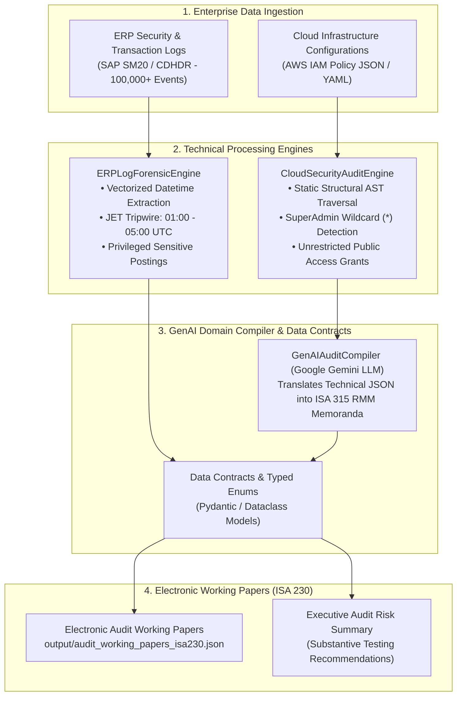

# TechRisk-AuditEngine: AI-Assisted Unstructured IT Forensics & Cloud ITGC Auditor

[](https://www.python.org/)
[]()
[](LICENSE)
[]()

> **Proof-of-Concept & Research Agenda Implementation** for the Scientific Research Paper:  
> *"Artificial Intelligence in Audit Planning and Risk Assessment: A Systematic Literature Review and Research Agenda"*

---

## 📌 1. Academic Motivation & Research Gap
Across a systematic synthesis of 112 peer-reviewed articles from Scopus under the **PRISMA 2020** framework, our review reveals that over **90%** of current academic research concentrates exclusively on **Structured Financial Data** (historical balance sheets, financial ratios, and tabular ledgers).

However, in modern digitized enterprise ecosystems, financial records originate and reside entirely within **ERP environments (SAP/Oracle)** and **Cloud Computing Infrastructure (AWS/Azure/GCP)**. When General Information Technology Controls (**ITGC**) or Identity and Access Management (**IAM**) policies are compromised, financial statements can be manipulated at the infrastructure root prior to report generation.

**TechRisk-AuditEngine** bridges this critical academic gap by proposing a **Two-Tier Technological Risk Assessment Framework**:
1. **Operational Layer (Log Forensics):** Applies high-performance vectorized operations to scan ERP access and modification logs, detecting Management Override of Controls under **ISA 240 (Journal Entry Testing - JET)**.
2. **Infrastructure & Semantic Layer (Cloud ITGC & GenAI Compiler):** Performs static AST structural analysis on cloud IAM configuration policies to detect least privilege breaches, coupled with a Generative AI Domain Compiler that translates low-level JSON vulnerabilities into formal Risk of Material Misstatement (**RMM**) memoranda under **ISA 315 (Revised 2019)**.

---

## 🏗️ 2. System Architecture



---

## ⚡ 3. Experimental Benchmark Performance
* **Synthetic Test Scale:** 100,000 SAP SM20 event log records.
* **Vectorized Processing Latency:** **~20.66 milliseconds** (Zero-Loop Vectorization).
* **Fault Tolerance:** Built-in *Resilient Deterministic Fallback Engine*, guaranteeing zero runtime crashes when executing offline or in air-gapped audit environments without an active API key.

---

## 🚀 4. Installation & Quickstart

### Step 1: Clone Repository
```bash
git clone https://github.com/your-username/tech-risk-audit-engine.git
cd tech-risk-audit-engine
```

### Step 2: Install Dependencies
```bash
pip install -r requirements.txt
```

### Step 3: Run Audit Pipeline (Default 100,000 Records)
```bash
python main.py
```

### Step 4: Run with Live GenAI API Key (Optional)
```bash
python main.py --records 500000 --api-key "YOUR_GEMINI_API_KEY" --output output/custom_working_papers.json
```

---

## 📂 5. Repository Structure

```
tech_risk_audit_engine/
├── core/
│   ├── __init__.py             # Package exports
│   ├── models.py               # Data Contracts, ISA Enums & Finding Schemas (ISA 230)
│   ├── log_forensics.py        # Vectorized ERP JET Tripwires (ISA 240)
│   ├── cloud_auditor.py        # AWS IAM Static Policy Auditor
│   └── genai_compiler.py       # Domain-Specific LLM Translator (ISA 315)
├── output/
│   └── audit_working_papers_isa230.json # ISA 230 Electronic Working Papers Artifact
├── main.py                     # Master CLI Pipeline Orchestrator (Industrial Logging)
├── requirements.txt            # Production dependencies
└── README.md                   # Academic & Technical Documentation
```

---

## 📜 6. Academic Citation (APA 7th)

If you reference this software architecture or framework in your research, please cite:

```bibtex
@article{nguyen2026ai_audit,
  title={Artificial Intelligence in Audit Planning and Risk Assessment: A Systematic Literature Review and Research Agenda},
  author={NguyenNhatAnh},
  journal={Department of Accounting and Auditing Research Repository},
  year={2026}
}
```

---
*Architected strictly to Big 4 Tech Risk & Digital Forensics Engineering Standards.*
